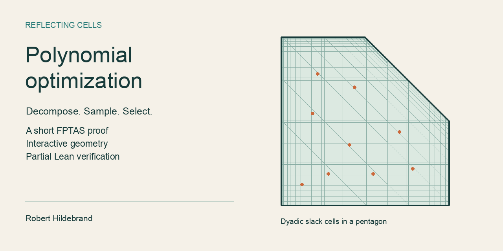

# Polynomial optimization by reflecting cells



**[Explore the interactive guide →](https://roberthildebrand.github.io/FPTAS-Polynomial-Optimization/)**

**A short proof of a range-relative FPTAS for polynomial integer optimization over bounded polyhedra.**

Refine dyadic intervals for the constraint slacks, find one feasible integer representative in each cell, and return the representative with the best objective value. Reflecting geometry supplies long integer progressions; Markov’s polynomial derivative inequality controls the approximation error. The dimension is fixed, and the feasible polyhedron is bounded.

## Start here

| If you want to… | Open |
| --- | --- |
| Explore the algorithm visually | [Interactive field guide](https://roberthildebrand.github.io/FPTAS-Polynomial-Optimization/) — live on GitHub Pages |
| Read the concise proof | [Short paper](reflecting_cells_fptas_short.tex) |
| See details and provenance | [Extended paper](reflecting_cells_fptas.tex) |
| Check the mathematics by hand | [Annotated review draft](reflecting_cells_fptas_review.tex) |
| Find the corresponding Lean theorems | [Verification guide](verification/README.md) |
| Inspect the reference checks | [Reference audit](verification/reference_audit.txt) |

The interactive guide is available on GitHub Pages and also runs offline with no installation or external libraries. Download or clone the repository, then open `docs/index.html`. GitHub’s file viewer displays HTML source; it does not run the guide. The page includes a pentagonal cell explorer, quadratic/cubic/quartic objectives, exhaustive comparisons on a small lattice, and an interactive symmetrization plot. [Demo details and tests](docs/README.md).

## What is verified?

**256 Lean theorem declarations across eight modules pass the axiom audit. The complete FPTAS is not formally verified.**

The checked mathematics includes the shifted-slack geometry, sampled approximation estimate, chamber coverage and counting, mixed-integer reduction, scaled polynomial representation, and complete LP query encoding with polynomial-size absorption. Results retain their explicit hypotheses. Classical Markov inequalities, published geometric inputs, oracle implementations, and full algorithmic bit costs remain outside the certification.

The [coverage guide](verification/README.md) maps paper statements to declarations and explains every boundary of the formalization. The [run record](verification/last_run.json) binds the successful audit to the exact source and draft hashes.

## Run the checks

Prerequisites: Python 3, Git, and [elan](https://github.com/leanprover/elan). From the repository root:

```sh
cd verification/lean
lake exe cache get
cd ../..
python3 verification/check_all.py
```

The toolchain and Mathlib revision are pinned. Do not run `lake update` for reproduction. Initial setup requires network access and disk space for dependencies. A successful check reports **256 theorems; no custom axioms or `sorryAx`**.

```sh
# Check recorded hashes only (does not rerun Lean)
python3 verification/check_all.py --check-record

# Also run the exact small-instance experiments
python3 verification/check_all.py --experiments

# Test the interactive guide (Node.js; no package install)
node --test docs/explorer.test.js
```

The Python experiments are exact finite-instance sanity checks, not a runtime-qualified implementation of the FPTAS. The browser guide uses floating-point illustration and exhaustive enumeration; it is not Lean-certified code.

## Build and review the paper

With LaTeX, `elsarticle`, TikZ and PGFPlots installed:

```sh
pdflatex -interaction=nonstopmode -halt-on-error reflecting_cells_fptas_short.tex
pdflatex -interaction=nonstopmode -halt-on-error reflecting_cells_fptas_short.tex
```

The sources are standalone: figures and bibliography are embedded. Substitute `reflecting_cells_fptas.tex` for the extended version.

Regenerate the annotated review copy after editing the short paper:

```sh
python3 verification/make_review_draft.py
```

Blue notes identify conditional Lean coverage; amber notes identify human-review obligations. The review copy is not the submission version. See [CONTRIBUTING.md](CONTRIBUTING.md) for the update workflow.

## Repository map

```text
reflecting_cells_fptas_short.tex   Concise manuscript
reflecting_cells_fptas.tex         Extended manuscript and disclosure
reflecting_cells_fptas_review.tex  Generated annotated review copy
docs/                             Offline interactive field guide and tests
verification/                     Coverage guide, audit runner and run record
  lean/                           Eight checked modules, pinned build and logs
experiments/                      Exact rational finite-instance checks
```

`verification/lean/ReflectingCells.lean` and its standalone checker are historical explorations, excluded from the current build and 256-theorem audit. They remain at their original paths for provenance. The earlier cubic calculations mentioned in the extended disclosure belong to the separate `Unbounded-Cubic-Integer-Programming` project and do not certify this FPTAS.

The project was transferred to this repository on October 14, 2026. Authorship, AI assistance, and verification scope are documented in the extended manuscript. Repository citation metadata is provided in [CITATION.cff](CITATION.cff); this is a research manuscript, not a claim of journal acceptance.
